<div align="center">

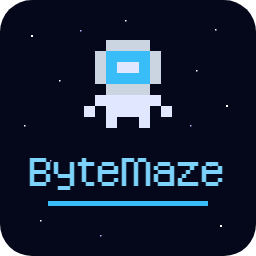

# ByteMaze

**Escape the space station.** A pixel maze game in C++17 and raylib: find key cards, open airlocks and reach the portal before the fog swallows you.

[](#-build-and-run)
[](https://www.raylib.com/)
[](#windows-visual-studio-2026)
[](#-build-and-run)
[](#-tested)

[Play it](#-build-and-run) · [How to play](#-how-to-play) · [How it works](#-how-it-works) · [Tests](#-tested) · [Documents](#-documents) · [Team](#-team)

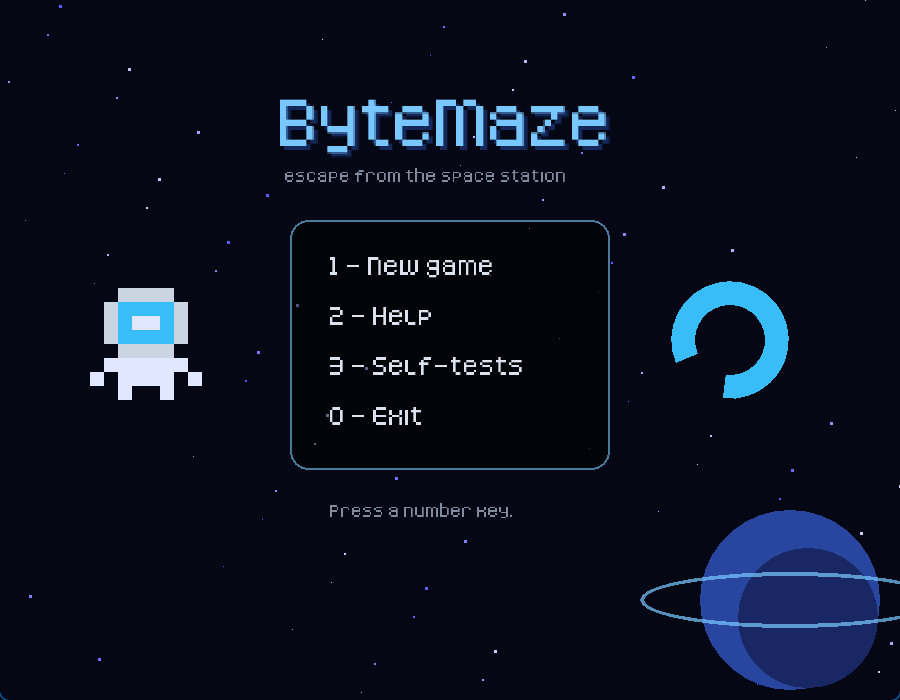

</div>

---

## ✨ What makes it fun

| Feature | What it means |
|---|---|
| 🧭 **A new maze every time** | Mazes from 10×10 to 50×50, generated randomly. There is always a way out. |
| 🔑 **Key cards and airlocks** | Airlocks block the shortest way. Find a key card first, then open the door. |
| 🌫️ **Fog of war** | On Medium and Hard you only see the cells around the astronaut. |
| 🎚️ **Three difficulty levels** | Each level has its own look: a station in the stars, a hologram, an emergency alarm. |
| ⏱️ **Time and score** | Fewer moves and seconds give more points. Your best score for every size and level is kept. |
| ✅ **Built-in self-tests** | Press <kbd>3</kbd> in the menu and the game checks its own logic: 13 tests. |

## 🖼️ Screenshots

<table>
  <tr>
    <td align="center">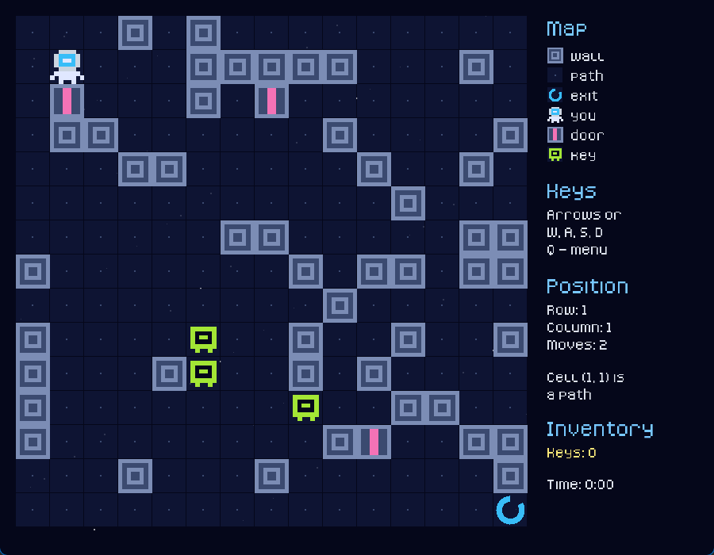<br><sub><b>Easy</b> · stars, no fog</sub></td>
    <td align="center">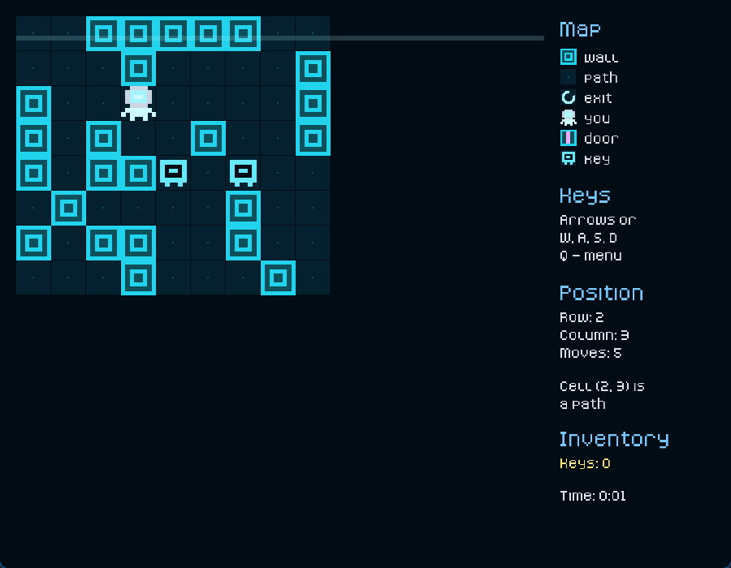<br><sub><b>Medium</b> · hologram, fog 5 cells</sub></td>
    <td align="center">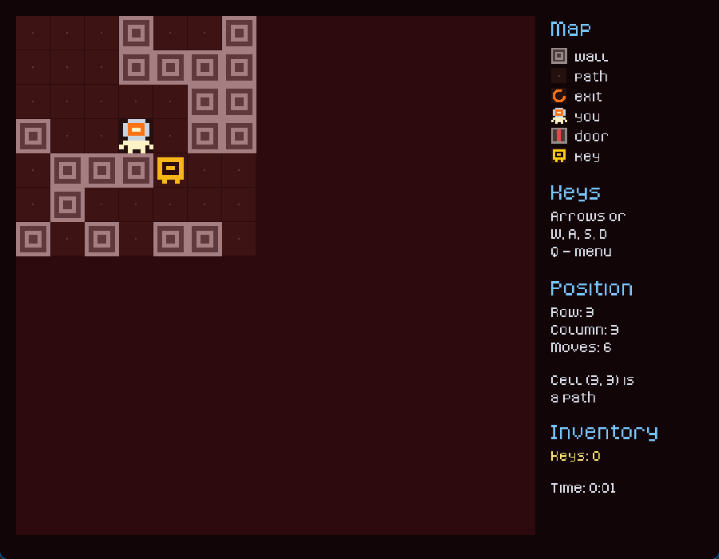<br><sub><b>Hard</b> · alarm, fog 3 cells</sub></td>
  </tr>
  <tr>
    <td align="center">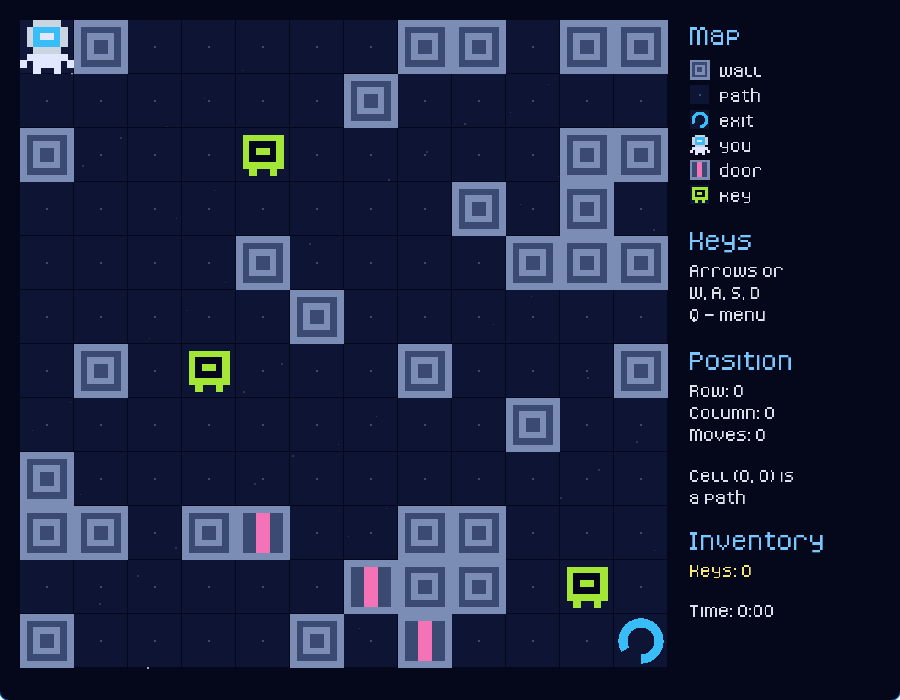<br><sub><b>Airlocks and key cards</b></sub></td>
    <td align="center">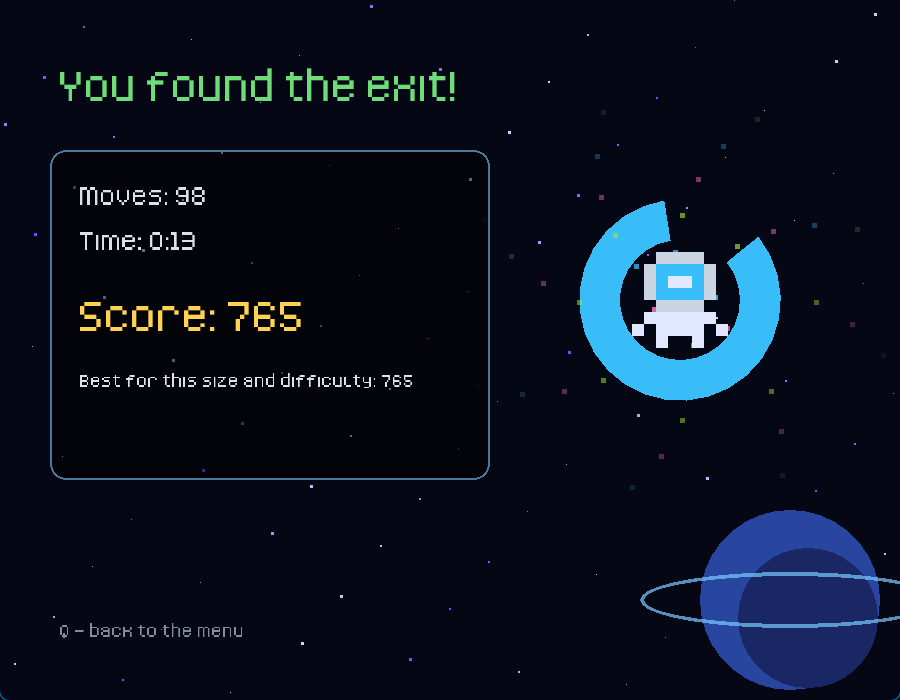<br><sub><b>You found the exit!</b></sub></td>
    <td align="center">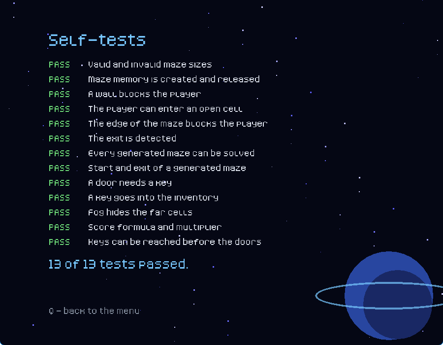<br><sub><b>13 of 13 self-tests</b></sub></td>
  </tr>
</table>

## 🚀 Build and run

The raylib library is already in the repository, so there is nothing else to install on Windows.

### Windows (Visual Studio 2026)

1. Clone the repository:
   ```bash
   git clone https://github.com/TatianaKovacheva/ByteMaze.git
   ```
2. Open `Maze-Project.sln` in Visual Studio 2026.
3. Choose **Debug** or **Release** and **x64**, then press <kbd>F5</kbd>.

The project builds with **0 errors and 0 warnings** (warning level 4).

### macOS (clang)

Install raylib for macOS in `~/raylib` once, then run this from the `ByteMaze` folder:

```bash
clang++ -std=c++17 src/*.cpp -I external/raylib/include ~/raylib/lib/libraylib.a \
  -framework CoreVideo -framework IOKit -framework Cocoa -framework GLUT \
  -framework OpenGL -framework QuartzCore -o /tmp/bytemaze && /tmp/bytemaze
```

> [!TIP]
> Start the game from the `ByteMaze` folder. It loads the font from `assets/fonts/`. Without it the game still runs, with the raylib font.

## 🎮 How to play

1. Press <kbd>1</kbd>, type a size from **10** to **50** and press <kbd>Enter</kbd>.
2. Choose the difficulty: <kbd>1</kbd> Easy, <kbd>2</kbd> Medium or <kbd>3</kbd> Hard.
3. Start in the top-left corner and reach the portal in the bottom-right corner.

| Key | Action |
|---|---|
| <kbd>↑</kbd> <kbd>↓</kbd> <kbd>←</kbd> <kbd>→</kbd> or <kbd>W</kbd> <kbd>A</kbd> <kbd>S</kbd> <kbd>D</kbd> | Move one cell |
| <kbd>Q</kbd> | Back to the menu |
| <kbd>2</kbd> in the menu | Help |
| <kbd>3</kbd> in the menu | Self-tests |
| <kbd>0</kbd> in the menu | Exit |

### The map

| Icon | Name | What it does |
|---|---|---|
| ▣ | Wall panel | You cannot walk through it. |
| · | Path | You can walk here. |
| 🧑‍🚀 | Astronaut | That is you. |
| 🟪 | Airlock | Needs one key card. Then it opens for good. |
| 💳 | Key card | Step on it to put it into your inventory. |
| 🌀 | Portal | The exit. |

### Difficulty levels

| | Easy | Medium | Hard |
|---|:---:|:---:|:---:|
| Open cells | 70% | 60% | 45% |
| Fog | none | 5 cells | 3 cells |
| Airlocks and key cards | 3 | 2 | 1 |
| Score multiplier | ×1 | ×2 | ×3 |
| Look | station in the stars | hologram | emergency alarm |

<details>
<summary><b>🏆 How the score is calculated</b></summary>

<br>

```
score = max(100, 1000 − 2 × moves − 3 × seconds) × multiplier
```

Example: 38 moves in 58 seconds on Easy gives `1000 − 76 − 174 = 750` points.
The best score is kept for every size and difficulty while the game is running, and **New best result!** blinks only when you beat it.

</details>

## 🛠️ How it works

<details>
<summary><b>🧱 How a maze is generated</b></summary>

<br>

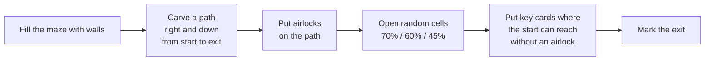

- The carved path guarantees that a way to the exit always exists.
- The airlocks stand **on** that path, so on Hard you often need a key card.
- The key cards are found with a **recursive flood fill** from the start that stops at walls and airlocks. There is one key card for every airlock, so every maze can be solved.

</details>

<details>
<summary><b>🔁 The game loop and the screens</b></summary>

<br>

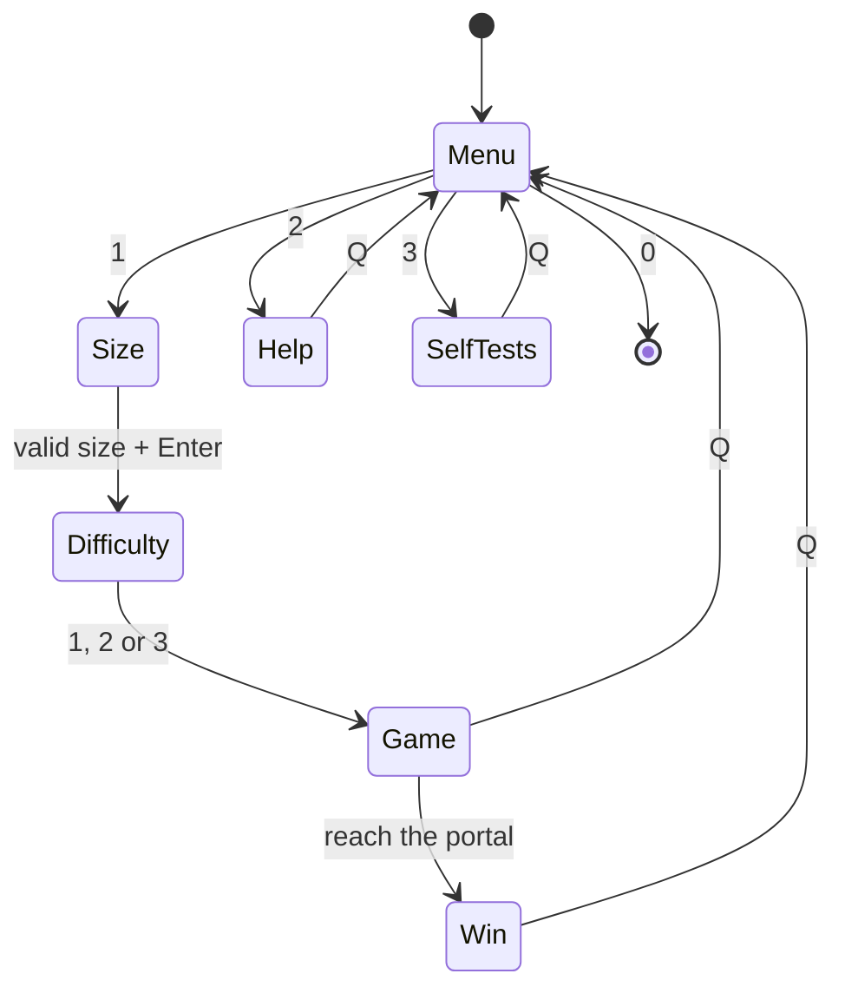

Every frame (60 per second) the game first reads the keys and updates the active screen, then draws it. No function waits for a key, so the window never freezes.

</details>

<details>
<summary><b>🧠 Dynamic memory</b></summary>

<br>

The maze is a `char**`: an array of row pointers, each pointing to an array of `size` cells, created with `new[]` and released with `delete[]` after a win, on <kbd>Q</kbd> and when the window closes. The self-test *Maze memory is created and released* checks it with the Visual Studio debug heap.

</details>

<details>
<summary><b>🎨 Pixel icons without image files</b></summary>

<br>

Every icon is an 8×8 table in the code. `1`, `2` and `3` are three colors and `.` is an empty pixel:

```cpp
const char* const PLAYER_ICON[8] = {
    "..2222..",
    ".233332.",
    ".231132.",
    ".233332.",
    "..2222..",
    ".111111.",
    "1.1111.1",
    "..1..1.." };
```

`drawIcon` draws such a table in a cell of any size, in the colors of the difficulty level. The stars, the hologram line, the alarm and the turning portal all depend only on `GetTime()`, so they need no extra variables.

</details>

### Project structure

```
ByteMaze/
├── src/
│   ├── main.cpp      the window and the screens
│   ├── Maze.h/.cpp   game logic: memory, generation, moves, doors, fog, score
│   ├── GameUI.h/.cpp everything you see and press: drawing and keys
│   └── Tests.h/.cpp  13 self-tests
├── assets/fonts/     Kenney Pixel font
├── external/raylib/  raylib 6.2 (header and library)
└── docs/             QA test plan and images
```

The game logic in `Maze.cpp` has no input or output at all: every function only changes data and returns a result. That is why it can be tested automatically.

## ✅ Tested

<details>
<summary><b>13 self-tests</b> (press <kbd>3</kbd> in the menu)</summary>

<br>

| # | Test |
|---|---|
| 1 | Valid and invalid maze sizes |
| 2 | Maze memory is created and released |
| 3 | A wall blocks the player |
| 4 | The player can enter an open cell |
| 5 | The edge of the maze blocks the player |
| 6 | The exit is detected |
| 7 | Every generated maze can be solved |
| 8 | Start and exit of a generated maze |
| 9 | A door needs a key |
| 10 | A key goes into the inventory |
| 11 | Fog hides the far cells |
| 12 | Score formula and multiplier |
| 13 | Keys can be reached before the doors |

</details>

The full QA test plan with 12 test cases and 69 steps (all PASS) is in [`docs/QA_Test_Plan.docx`](docs/QA_Test_Plan.docx).

## 📚 Documents

| Document | What is in it |
|---|---|
| 📘 [Technical documentation](docs/Technical_Documentation.docx) | The game and its rules, the requirements of the task, the project structure, the algorithms with block diagrams and the part of every team member |
| 🎞️ [Presentation](docs/ByteMaze_Presentation.pptx) | The slides for the defense |
| ✅ [QA test plan](docs/QA_Test_Plan.docx) | 12 test cases with 69 steps and their results |

<details>
<summary><b>🧭 Block diagrams</b></summary>

<br>

<table>
  <tr>
    <td align="center"><a href="docs/images/flow-main.png">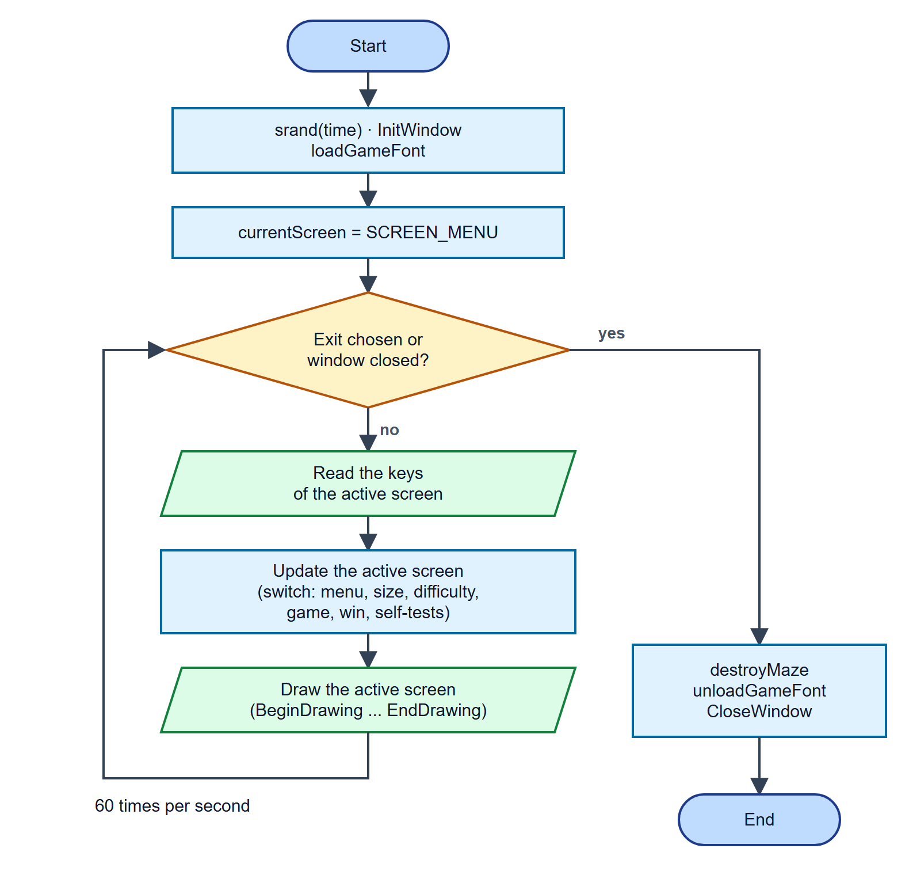</a><br><sub><b>The main program</b></sub></td>
    <td align="center"><a href="docs/images/flow-generation.png">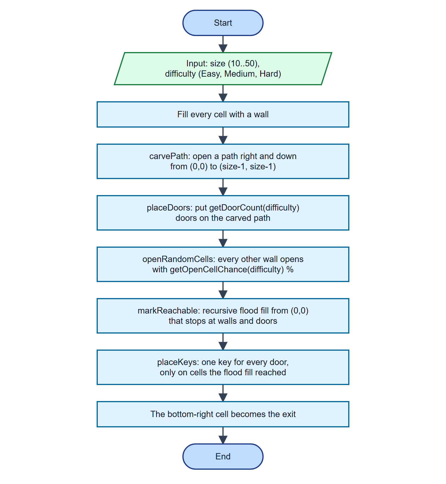</a><br><sub><b>Maze generation</b></sub></td>
    <td align="center"><a href="docs/images/flow-move.png">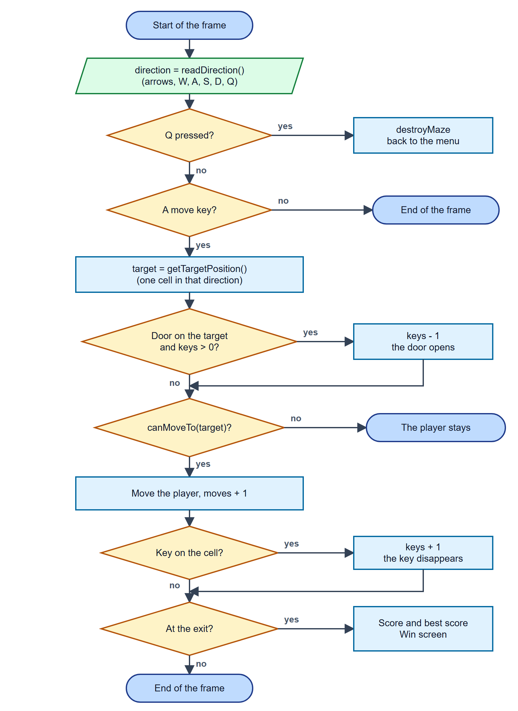</a><br><sub><b>One move</b></sub></td>
  </tr>
</table>

</details>

## 👥 Team

<table>
  <tr>
    <td align="center"><a href="https://github.com/TatianaKovacheva"><br><b>Tatiana Kovacheva</b></a><br><sub>Scrum trainer<br></td>
    <td align="center"><a href="https://github.com/PNRusev24"><br><b>Plamen Rusev</b></a><br><sub>Frontend<br></td>
    <td align="center"><a href="https://github.com/MustafaMustafa25"><br><b>Mustafa Husein</b></a><br><sub>Backend<br></td>
    <td align="center"><a href="https://github.com/DimitarNyagalov"><br><b>Dimitar Nyagalov</b></a><br><sub>QA<br></td>
  </tr>
</table>
